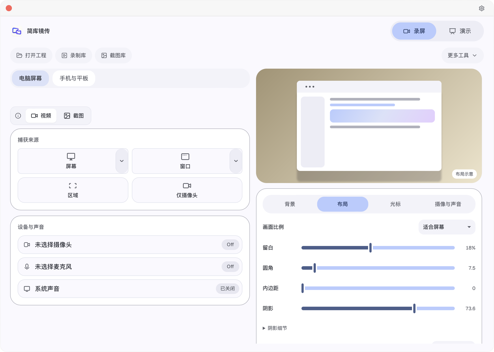
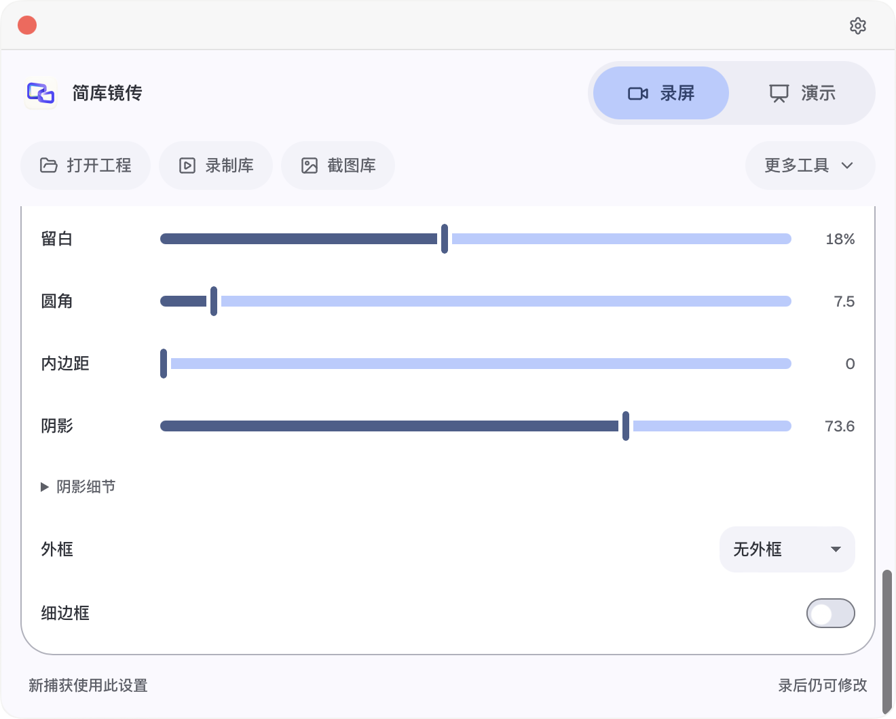

# 0.2.0-alpha.14 界面与录前设置验证

`verification.json` 记录构建、签名、检查范围、通过项目与限制；`ui-smoke.json` 是打包应用实际输出，`ui-observations.json` 是各窗口的 DOM 与颜色角色观测。配图只包含本项目界面和合成布局，不包含真实壁纸图像或手机内容。

已检查工作台在 1120×800 与 660×530 的尺寸、滚动、留白保存、演示设置同步、壁纸取色、自选颜色切换及恢复。屏幕录制、辅助功能、摄像头与麦克风在最后一次应用检查中均为已授权。视频编辑器与截图编辑器用合成工程确认首帧和界面；这不是完整录制、长时间播放或全功能导出验收。

默认颜色来自实际壁纸种子。图中当前出现的颜色由本机壁纸产生，不是固定蓝紫主题；可在“设置 → 通用 → 配色”选择基本配色、自选种子、风格和对比度。界面配色不改写已有媒体工程的画面。

原生相关检查使用 `cargo check --locked -p cap-desktop --features tauri/custom-protocol`，测试组记录在 JSON。前端执行桌面 TypeScript 检查，以及 `color-scheme.test.ts`、`expressive-motion.test.ts` 和 `editor-layout.test.ts`。打包采用既有 Tauri 构建与项目签名脚本，严格验证实际复制的应用。

调试验收钩子仅在 debug 构建且显式提供 `JIANKU_EXPRESSIVE_SMOKE_OUTPUT` / `JIANKU_UI_REVIEW_OUTPUT` 时运行。普通启动不执行窗口调整、设置切换或测试工程打开。测试会恢复自己的临时留白与颜色选择。

后续人工与设备验收继续使用[交接文档](../../../docs/待验证项目交接.md)，设计依据和实现边界见[界面说明](../../../docs/界面设计与录前预设.md)。
