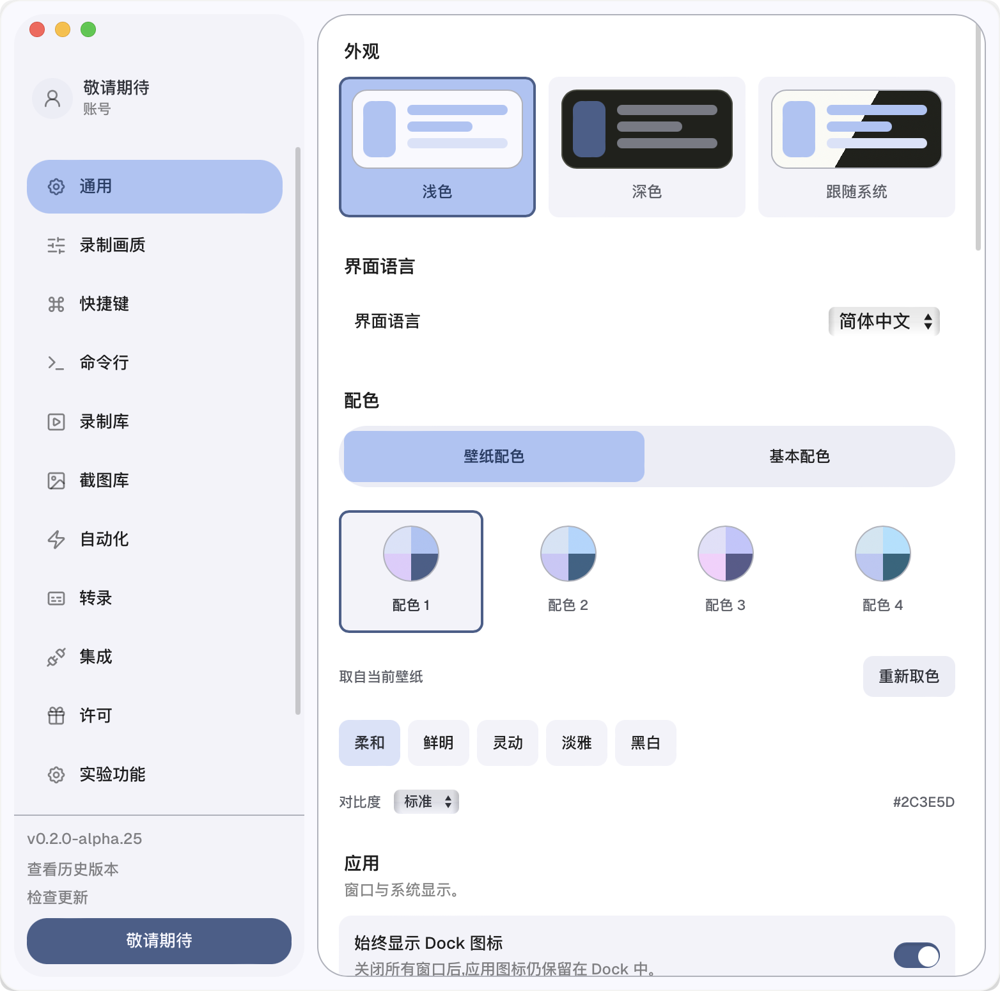
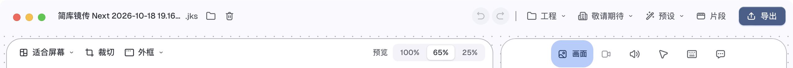
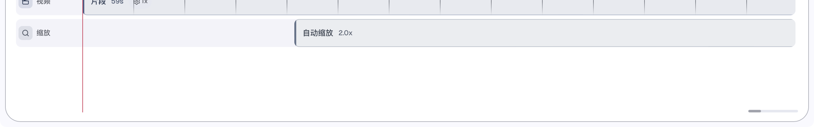

# alpha.25 回归验证

2026-10-18，本机 macOS 14.7.4。运行包固定安装于 `/Applications/Jianku Screen Next.app`。下述自动化窗口验证使用打包后的 debug 应用，不依赖开发服务器。

## 播放、暂停、回到开头再播放

使用现有约 59 秒的 `.jks` 工程及本机 3840×2160、239.76 fps 系统视频壁纸。录制画面含私人桌面，因此不收录工程、完整截图、录制视频及系统壁纸素材。

- alpha.23：播放到 30.55 秒后暂停；标尺回退后再调用编辑器同一路径的 `seek_to(0)`，确保定位到绝对开头。再次播放的八次一秒采样中，时间始终为 0:00.00，收到的画面数始终为 1861。
- alpha.25：通过真实界面播放至 30.53 秒、暂停、回到开头、标尺定位到 0 秒、再次播放。一秒后时间为 0:00.54，收到画面数从 1858 增至 1912；二秒后为 0:01.53、1972 帧；随后持续更新至 0:05.54。

暂停会从实时壁纸切换到精确取帧。旧精确解码器首次请求中途画面时没有执行跳转，会从开头解码；即使用户随后回退并播放，旧请求仍占着渲染通道。修复包括首次请求跳转、播放请求打断旧的背景等待、原生解码逐帧检查取消。取消仅发生在背景准备的等待阶段，GPU 提交与读回仍正常完成。旧播放会话的结束不会取消新会话。

保留原分辨率、光标、阴影、缩放、模糊及实时/精确解码分工。精确定位在长 GOP、高帧率素材上仍可能耗时；本轮消除的是旧定位阻塞新播放，不保证所有壁纸的任意位置单帧定位瞬时完成。

## 设置导航选中底色

原先 `.cap-settings-nav` 列表独立滚动，选中底色位于其父层。现在滚动发生在共享的 `MotionGroup` 容器内，列表与底色采用同一坐标系，原有弹簧参数保持不变。

真实设置窗口中，导航可视高度 522、内容高度 614；滚动 70 像素后，底色与“通用”按钮的水平/垂直位置差均为 0。随后切换“录制画质”及返回“通用”，垂直误差均小于 0.004 像素。

## 文案与启动路径

实际编辑器确认：预览画质为 100% / 65% / 25%，旧自动名称显示为“简库镜传 Next + 日期时间”，时间线显示“自动缩放”；按键、字幕的模型/语言/样式/字重等面板为中文。设置中账号入口、检查更新等不再裸露英文。用户自定义名称不会被当成自动日期格式改写。

此前还存在多个应用副本注册，以及四段原生构建号的第四段被系统忽略的问题。现采用三个数字段的 `CFBundleVersion=2026.25.0`，统一安装到“应用程序”，安装器保留上次安装备份并取消其他副本的启动注册，绑定项目专用 UTI，不修改普通文件夹的打开方式。[Apple 的构建号说明](https://developer.apple.com/documentation/BundleResources/Information-Property-List/CFBundleVersion)。

将旧 alpha.20 重新注册后，按应用标识查找及 `.jks` 默认打开程序仍指向 `/Applications/Jianku Screen Next.app`；验证后已取消该旧副本注册。

最终 release 构建与严格签名检查通过，已安装到固定路径并保留上次 debug 安装备份。在确认没有应用进程后，通过系统默认关联打开既有 `.jks`，冷启动得到正确的编辑器窗口。安装后可执行文件与 release 构建的 SHA-256 完全一致，结果见 [交付记录](delivery.json)。历史构建目录另保留 `0.2.0-alpha.25/Jianku Screen Next.app`。release 窗口截图再次确认新品牌名称、100% / 65% / 25% 和“自动缩放”。

## 检查与范围

- `cargo fmt --all`、`cargo check -p cap-editor -p cap-rendering` 通过。
- 播放意图、准备阶段切换、帧通道、时间线跟随共 41 项前端测试通过。
- 本地化、名称显示与标题保存共 22 项前端测试通过；安装器 3 项测试通过。
- 实际系统壁纸上的 3 项原生测试通过：中途首次精确取帧及回退、取消定位后回退、连续取帧及重复像素。精确帧与原 FFmpeg 路径的时间戳一致，平均像素通道差约 0.863；这不是逐像素完全相等的声明。
- Biome 对改动源码的检查通过；CSS 原有的 4 条“减少动态效果”`!important` 警告保留。前端构建原有的 stdin 解析诊断仍会打印，后续生产构建继续完成，实际打包界面已验证；未声称构建完全无警告。

完整双语逐页验收、新录制默认名、录制/截图/演示权限回归、带音频和复杂时间线的反复跳转仍见单独交接文档。本次不把上述局部验证扩大为所有功能均已通过。

`observations.json` 仅保存控件文字、时间、帧计数及导航几何结果；`review.js` 是供 debug 包初始化钩子运行的本地回归脚本，要求手动打开至少 32 秒的测试工程，运行后暂停播放、打开设置并恢复“通用”页。不下载字幕模型、不上传媒体、不导出或删除工程。

