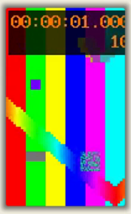

# alpha.28：安卓静止尾段与动态壁纸索引

日期：2026-10-25。此阶段承接 alpha.27 的可选窗口过滤，处理 V2-Mobile-11 与反复切换播放/暂停时的动态壁纸精确读取开销。

## 实现

Android 录制使用固定版本的 scrcpy 4.1 客户端及匹配服务端。源码补丁、下载哈希、构建脚本与 Apache-2.0/SDL 许可随源码保存，客户端复用应用 FFmpeg。只在正常停止且已收到视频包时，根据首包到达和停止的单调时钟延长最后一个视频样本的保持时间；设备流关闭或错误先发生时保留原行为。视频包内容、既有 PTS/DTS 与音频不重编码或统一拉伸。应用计时从首视频包事件开始，并保存客户端时间证据；新录制用设置的最高帧率作取帧索引精度，旧素材回退到有效标称帧率，避免静止尾段拉低平均帧率而折叠前段画面。

动态壁纸精确读取复用同一文件的 NV12 关键帧时间索引，最多保留 8 份、索引数据 8 MiB。文件修改或替换后失效，取消及扫描期间变化的结果不发布；扫描不占用缓存锁。缓存保存时间索引，不保留像素或系统视频缓冲。精确帧选择和画面效果沿用现有实现。

## 已验证

- [12 组录制包对照](android-packets.json)：静止、静止中段、音频与视频不同起点、正常停止、异常以及 EOS 先到。正常静止原始流从 1.1 秒完整保持至 6 秒；错误和提前断流仍为 1.1 秒，避免假造缺失内容。压缩包 hash、PTS/DTS 对照与完整解码通过。
- [壁纸缓存结果](wallpaper-cache.json)：缓存复用、文件修改/原子替换、取消和容量限制通过。CFR/VFR 两份自制素材各 9 个定位点，重新打开前后 PTS 和像素完全一致；另各 12 个 FFmpeg 参考点在原有误差门限内。
- 60 秒、120 fps、960×540、80 MB 自制素材的一次本机测量：索引扫描 22.47 ms，缓存查找 0.0085 ms。首次/再次原生打开的 290.29/7.08 ms 包含 AVFoundation 冷启动影响，不能全部归因于此优化，也不代表整段导出或所有预览提速相同比例。
- 17 项移动录制/恢复/计时测试与替换后的专用客户端选项测试通过；构建脚本连续执行两次成功，避免重复复制只读库失败。打包 debug 应用的客户端可在没有 DYLD 覆盖的环境启动。
- [新版导出回归](android-export-alpha28.json)：两份合成素材均完成 6 秒/360 帧成片和完整解码，静止后半段像素一致；使用 60 fps 的源取帧网格。
- [编辑器回归记录](editor-playback.json) 区分旧版对照和新版打包验证；帧计数来自预览传输消息，不冒充屏幕实际显示帧率。

优化版 `0.2.0-alpha.28`（构建号 `2026.28.0`）已统一安装、归档并打开，源包/安装/归档的主程序 SHA-256 一致，严格签名检查通过；详见 [delivery.json](delivery.json)。实际编辑器与导出场景在打包 debug 版本验证，优化版单独核对构建、安装、包内组件和启动。本目录不提交真实手机视频、私人录制、完整桌面截图或系统壁纸。

## 复跑与边界

先在 `next/cap` 中运行 `node scripts/build-android-capture.mjs`，再运行 `python3 scripts/scrcpy/test-recording-tail.py` 可执行录制包对照。`verify-wallpaper-cache.py --repo <next/cap绝对路径> --make-fixtures` 创建自制素材并运行相关精确读取测试；生成素材的机器与编码器不同，hash 和耗时也可能不同。实际测量素材的 hash 保存在结果 JSON 中。

正常停止的保持时间以首视频包接收时钟对齐，仍包含传输延迟；不能以合成包测试代替物理设备长时间音画同步验收。真实安卓、音频/预览组合、插拔与长录制、iPad、跨屏/会议共享、长 GOP 的实际逐帧解码等待及其他剩余项目仍见 [交接清单](../../../docs/待验证项目交接.md)。独立导出进程首次打开依然要建立索引，本轮不宣称已经完成整体导出性能优化。
