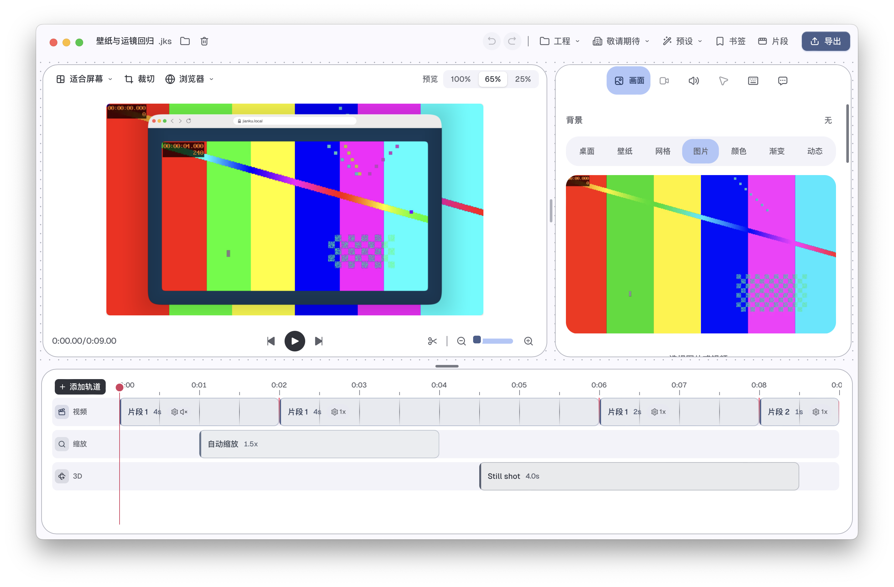

# alpha.35：动态壁纸播放交接与暂停定位

日期：2026-10-26。用户已经确认 alpha.34 原“内边距合成示例”的回晃问题解决，此结论仅关闭该示例的主观回测。本轮继续编辑器稳定性与缩放组合，不改变动画曲线、模糊核、强度或画质，也不要求设备实测。

## 根因与实现

原 `BackgroundLayer::set_realtime` 在精确预览和连续播放之间切换时，丢弃视频读取器、纹理与原生帧缓存。再次暂停要重建精确读取器，播放则重建 AVPlayer。共享实时预览的暂停路径还在沿用播放器当前时间/缓存帧；在小于 2 秒的向前定位中不会定位到目标，回拖或循环异步定位期间也可能拿到旧帧。

现在同一活动背景保留一个精确读取线程和按需创建的播放器；暂停会明确停止播放器、清空连续播放缓存，改用精确 NV12/GPU 取帧。再次播放时保留播放器对象并重新定位，定位完成前不会发布其旧像素。精确读取器和纹理在播放模式交接时复用；切换背景文件、切换到静态/生成背景或关闭渲染层，仍沿用既有资源释放路径。AVPlayer 或原生转换失败保留原有后备通道。

## 验证

- [原版记录](before.json)：自制 6 秒 H.264 壁纸，三轮播放后暂停前拖、回开头、跨循环，16 个检查点中的 9 个画面与精确参考不一致；[原始失败日志](before.log)保留。
- [修复后](after.json)：同样流程及末尾定位/回拖共 18 个检查点，完整 960×540 RGBA 输出与独立精确参考逐字节一致。检查使用真实主线程 AVPlayer、Metal 合成与相同背景、内框/阴影参数，不以模拟状态代替取帧。
- [长 GOP](long-gop.json)：60 秒/3600 帧、只有一个关键帧的自制 H.264，18 个检查点均一致，包括循环以及 59.5 秒定位后回开头。这个首次末尾定位仍约 2.51 秒，首次长 GOP 解码性能继续待办。
- [时间对照](comparison.json)：同机 debug 的模式交接渲染约 83–98 ms → 52–54 ms，样本各三次；包含原生等待及 GPU 合成，不宣称等比例改善全部预览、导出或物理屏幕帧率。暂停精确取帧的工作量大于原先错误的旧帧复用，不能用旧帧速度作为正确定位的门限。
- [内框相关回归](inset-tests.log)：10 项通过。新增 4 种裁剪/位置偏移/非中心手动焦点/浏览器、macOS、平板外框/3D 组合，各 8 个放大、缩小、回零和重定位点共 32 组；持续预计算与定位准备、保留图层与新图层的整帧像素相同。此为确定性回归，不等于所有组合的主观观感已验收。
- [精确读取对照](precise-tests.log)：12 个 PTS 与 FFmpeg 参考匹配，像素均差低于原有门限。新增暂停实时来源仍使用原生精确通道的检查、重新打开读取器的 9 点整帧一致性通过。[壁纸测试日志](wallpaper-tests.log)另外 3 项高帧率测试因未配置其专用 4K 素材直接返回，**不计作本轮有效覆盖**。
- [显示相关回归](display-tests.log)、[导出缩放一致性](export-equivalence.log)、[共用渲染编译](rendering-check.log)、[Rust 格式](fmt.log)通过。未修改 TS/CSS、生成绑定、录制器或播放队列，没有重复运行前端全仓检查。

素材由 FFmpeg `testsrc2` 生成：960×540/60 fps，分别 6 秒/GOP360 与 60 秒/GOP3600，libx264 fast、CRF20、yuv420p、关闭场景切关键帧。哈希、尺寸与帧数见 [素材清单](fixtures.json)；不提交私人录制或系统壁纸。

复跑：在 `next/cap` 中使用 `cargo run --locked -p cap-rendering --example wallpaper-handoff-check -- --video <自制视频绝对路径> --duration-frames <60×秒数> --output <新结果文件>`。程序在主线程处理系统事件，工作线程运行共享 GPU 渲染；macOS 专用，无额外开发服务器。长 GOP 运行时间受素材与硬件影响。Rust 检查使用完整 Xcode，Cargo 自动配置仓库原生库路径，不直接脱离其环境运行示例二进制。

## 首次定位的补充实验

构建期间另做一次独立 AVAssetReader 范围实验，见 [代码](seek-probe.swift)和[原始结果](seek-probe.json)：同一 59.5 秒画面的 NV12 哈希相同；从关键帧读取 3571 个输出样本约 1.43 秒，直接从目标时间范围读取 1 个样本仍约 1.25 秒。此诊断与 Rust/GPU 检查并非相同环境，也未做交错重复；只能说明直接设置范围仍有明显等待，不能声称消除长 GOP 的首次解码成本。没有把实验改入产品。

## 交付与剩余范围

优化版 `0.2.0-alpha.35`（构建号 `2026.35.0`）已安装、归档，并从 `/Applications/Jianku Screen Next.app` 以普通工程参数打开“壁纸与运镜回归”。源包、安装包、归档的主程序 SHA-256 一致（`c213123a4f7c79718c61b6b375dcd63f7b24680cbc19f812633c73598051d536`），严格签名验证通过，使用 ad-hoc 签名，尚未进行正式开发者签名/公证。包内新构建 CLI 的 9 秒/540 帧、1280×720/60 fps、最高质量导出与全段解码通过，540 帧解码像素全部与 alpha.34 对照相同。 见 [交付核对](delivery.json)、[完整导出](export.json)、[解码像素比较](decoded-comparison.json)、[新构建辅助程序输入](sidecar-inputs.json)。实现 `afede2c` 与阶段文档/证据使用回滚标签 `next-v0.2.0-alpha.35` 备份；alpha.34 归档与标签保留。

只删除本次安装的临时 alpha.34 旧包，删除前与保留的 alpha.34 归档核对哈希和签名；逻辑文件大小约 0.294 GiB，不等于实测释放空间。未删除用户工程、源码、缓存或历史归档，见 [清理核对](staging-cleanup.json)。

仍保留长工程、复杂多轨/摄像头/音频同步、真实壁纸长期显示、跨工程/睡眠以及少见暂停重播竞态；3D 转场/分屏/接管与极端焦点继续扩展。物理设备、副屏和会议共享继续按用户要求顺延，Windows 与正式签名/公证后置。
