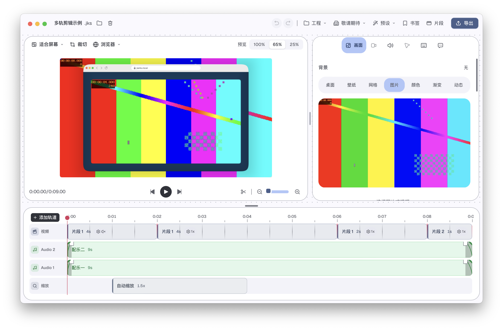

# alpha.36：播放中的多轨声音更新

日期：2026-10-26。本轮承接编辑器稳定性与多轨队列，不减少视觉效果、不修改弹簧或模糊参数。用户追加清理磁盘要求，清理范围与实测空间变化单独记录。

## 实现

原播放配置检查仅覆盖录制片段的裁剪、变速和音量。配乐音量、淡入淡出、启停/删除/替换、裁剪源区间、录制声音偏移、转场和全屏文字暂停未完整触发声音刷新。无声播放中后来加入配乐，也没有输出源。原始失败测试明确报告 `Missed music setting volumeDb`，见 [基线日志](before.log)。

现在比较实际影响声音的配置，忽略名称、配乐轨道排序位置、背景与纯摄像头偏移。配乐读取器只在声音控制线程加载新文件/区间，复用仍覆盖目标区间的音频，移除当前播放不再需要的配乐缓存；连续排队的同一次播放更新只处理最新修订，并保留停止、替换播放和清理的顺序屏障。回调中的代次与修订保护保持，准备失败或超时仍清理旧票据，不能复活已经停止的声音。

裁剪、变速、转场、全屏文字暂停或摄像头来源变化会清空旧映射的预读/帧缓存，并使用新的请求代次；生产器与播放时长按更新后的时间线计算，避免延长后只解码到旧结尾。此修改只更新播放中编辑的行为，静态配置的渲染、录制、导出混音逻辑保持。

## 已验证

- [20 个真实输出检查点](mix-summary.json)、[原始音频回调/视频记录](mix-final.json)：真实 EditorInstance、平台视频解码和 Metal 合成，生产音频回调的定时无设备输出。中途加入配乐、实时音量/淡入淡出、文件替换、裁剪至源 120 秒后的缓存外区间、启停、叠加和删除均得到预期 PCM；延长时间线后定位至旧结尾外仍有正确来源画面和声音；三轮暂停、回零再播放通过。
- 素材包括 120 秒/30 fps 灰度计时视频、两份 180 秒 PCM；四片段按不同源时间组成原 60 秒时间线，测试中延长至 70 秒。它不等于连续播放完整 120 秒或完整 10/30/60 分钟验收。开始为无声，配乐途中加入；保留缩放、内框、阴影和浏览器外框。素材清单见 [哈希](fixtures.json)，使用 [生成脚本](make-fixtures.py)可重建，不收录私人素材。
- [播放核心](core-playback.log) 28 项、[声音输出与交接](audio-output-tests.log) 20 项、[音频渲染/导出相关](audio-tests.log) 56 项通过（另 2 项既有性能测试忽略）、[事件所有权](event-tests.log) 3 项通过。过滤条件有重叠，不相加冒充独立覆盖数。
- [原生编译](editor-check.log)、[格式](fmt.log)、[所改 crate 的 Clippy](clippy-scoped.log)通过。额外含依赖的 Clippy 被既有 `rendering/src/live.rs` 三处同类型转换阻挡，见 [日志](clippy.log)；未抑制规则或修改无关实现。前端构建沿用既有转换诊断（alpha.35 与本轮均有 12 次相同的 `Expected ")" but found ":"`），最终静态构建与打包完成、实际界面和预览已打开；这个构建链诊断继续单独追踪，见 [构建日志](finish-build.log)。

## 已知失败保留

扩大过滤范围时，准备阶段“未完成工程/普通工程”整帧比较失败。单独运行与恢复 alpha.35 源码后都以相同像素失败：307200 字节中 1185 字节不同、最大差 8、均差约 0.00563，两个输出哈希与参考哈希在三次运行中分别完全一致。原断言和门限保留，不计为通过。见 [具体指标](preparing-existing-difference.json)及 [扩大范围](playback-tests-summary.log)、[单独运行](preparing-isolated-summary.log)、[alpha.35 基线](preparing-baseline-summary.log)；巨大像素数组不收录仓库，两端哈希、差值指标和紧凑诊断已归档；用户要求清理后，临时原始数组日志也已删除。此项进入下一阶段恢复/准备画面一致性队列。

## 优化版交付

优化版 `0.2.0-alpha.36`、构建号 `2026.36.0` 已安装、归档并以普通工程参数打开“多轨剪辑示例”。源包、安装和归档主程序 SHA-256 相同（`af4668d2a26b738135787dc3f690ff01767649bf7f5382ab46645114b1a26d59`），严格签名通过。包内新构建 CLI 的 9 秒/540 帧、1280×720/60fps、最高质量导出与完整解码通过；全部画面和解码 PCM 与 alpha.35 一致。同一闪烁/提示音素材的原生播放同步复测通过，649 帧，播放相对原始素材的音画偏差约 -8.45 ms（上一版 -10.64 ms），原有门限保持；不视作物理音频设备或 WebView 显示验收。 详见 [交付核对](delivery.json)、[完整导出](export.json)、[逐帧/音频比较](decoded-comparison.json)、[同步对照](sync-comparison.json)。实现 `fbcf455` 及阶段证据通过 `next-v0.2.0-alpha.36` 备份 GitHub，alpha.35 本机应用及标签保留。

## 磁盘清理

核对 GitHub 回滚标签后，删除 alpha.26–alpha.34 九份旧 `.app`，保留目录内其他文件以及当前 alpha.35 回滚应用，见 [清单](old-build-cleanup.json)。接着删除可再生成的 debug 增量编译缓存，见 [记录](incremental-cleanup.json)。确认全部所需 debug 检查结束且没有调试程序运行后，剩余 debug 构建也已删除，见 [记录](debug-build-cleanup.json)。运行中的发布构建仅使用单独的 release 目录，该目录及原生依赖保留。清理前后数据卷可用空间约 42→66 GiB，后续首次 debug 编译需重建。文件逻辑大小、du 分配大小与实测空闲量分别记录；APFS 克隆/快照及同时构建会影响差值，不能将它们等同。安装临时旧包已与 alpha.35 归档核对后清理，见 [核对](staging-cleanup.json)；自制测试副本、临时导出和旧阶段临时目录清理见 [清单](test-media-cleanup.json)。仅保留当前/上一版应用和当前自制试用工程，不触碰用户录制。

## 后续

10/30/60 分钟、多轨/摄像头/转场复杂组合、WebView 真实显示节奏、首次长 GOP 定位、音频实体设备/蓝牙、睡眠切换与跨工程，以及本节准备阶段像素差继续待办。Android、iPad、副屏/会议实测按用户要求顺延。Windows、正式开发者签名/公证后置。
