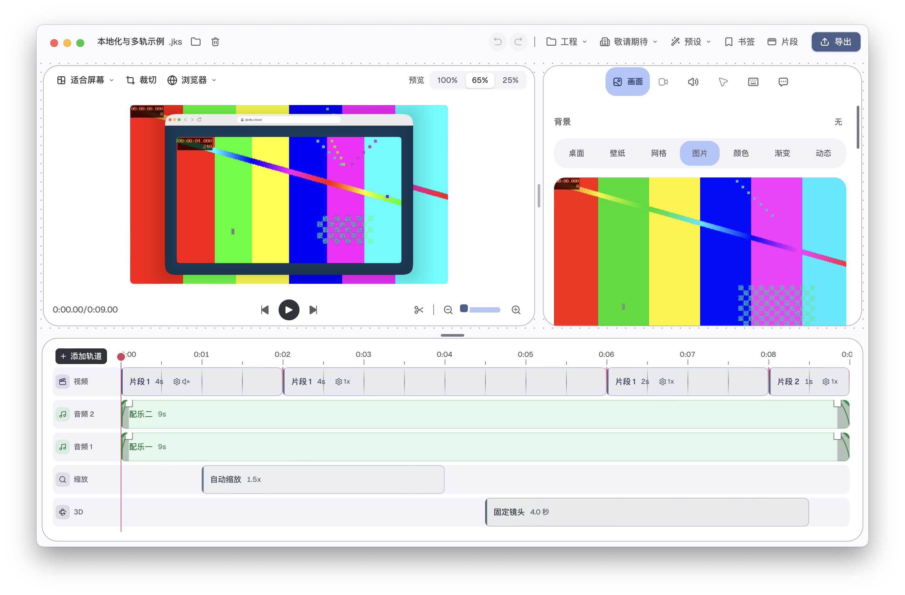

# alpha.37：动态文案、本地化与准备预览检查

日期：2026-10-26。本轮不改变图像合成、动画曲线、动态模糊、预览分辨率或录制/导出媒体逻辑。

## 产品修改

- 时间线中的音频、样式、图片、文字和遮罩轨道使用可翻译的编号模板，不再直接拼接英文；轨道拖动提示、选择提示和未命名音频的悬浮提示同步翻译。
- 3D 轨道中的固定镜头、预设名称、时长和镜头摘要在显示时翻译；不修改项目内的镜头参数或用户内容。准备编辑器的留白、圆角和阴影标签同步使用字典。
- 构建时的 `Expected ")" but found ":"` 来源已确认：路由分析将 `.ts` 验证脚本按 TSX 解析，泛型箭头函数出现 JSX 歧义。改为等价的普通泛型函数，保留其逻辑，不改构建工具或忽略错误。见 [解析错误证据](router-error.json)和[完整干净构建](frontend-build-clean.log)。

这只是已发现残留文案的收尾，**不等于全应用中文逐页验收完成**。字体/格式等内部标识与用户自定义名称不进行盲目替换。另扫描 166 个 TSX 文件，保留 [162 个静态候选位置](localization-candidates.json)供逐页检查，[扫描器](localization-inventory.cjs)可从 `next/cap` 依赖重跑。这些候选包含内部组件已经自行翻译的属性、技术名称和无障碍文案，不等于 162 个界面缺陷或完整覆盖；不会仅凭词典存在就判定已汉化。

## 准备预览差异的分类

原失败测试默认启用软件解码，但参考画面强制使用 FFmpeg 硬件解码。使用应用捆绑的解码器，在合成之前捕获可见 Y/U/V 平面：亮度完全一致，屏幕 U/V 各 9 字节相差 1、摄像头 U/V 各 50 字节最大相差 4。对应的整帧差异与上一轮指纹相同，见 [源平面指纹](decoded-planes.json)、[原始失败](raw-capture-summary.log)和[诊断补丁](diagnostic.patch.gz)。诊断会把源帧物化为 CPU 平面，只用来区分解码输入；该探针未进入产品代码。

现在测试显式使用实际应用的硬件配置，并另加软件对软件的完整像素对照。参考软件路径读取已经封装完成的同源文件，准备路径读取分段源；保持完整 RGBA 逐字节断言，同时验证重定位、定位、暂停/重播、交接与源资源释放。相关播放过滤共 43 项通过，包含新增软件检查；准备播放过滤的 17 项与此重叠，不能相加冒充独立数量。见 [播放检查](playback-tests.log)、[准备播放检查](preparing-playback.log)。

**仍有两项严格检查失败，未放宽门限。** 扩大到完整准备原生检查时，FFmpeg 硬件准备画面与默认 AVAssetReader 普通画面、以及 BGRA Surface 输出对照均在首帧失败。15 项通过、2 项失败；两项各 1155/307200 字节不同，最大差 7。恢复整份 alpha.36 原始测试源码后逐项复跑，也得到完全相同的输出/参考哈希；使用 try/finally 恢复当前测试修改。见 [本轮记录](native-preview-tests-summary.log)、[普通 AVAsset 基线](native_preparing_matches_default_avasset_editor_decoder-baseline-summary.log)、[Surface 基线](native_preparing_bgra_surface_matches_default_avasset_editor_frame-baseline-summary.log)、[差异指纹](failure-fingerprints.json)。这是继续待办，不宣称解决全部准备/正式预览差异，也不从当前证据推断其余原因。

## 检查与边界

- [前端 102 项](frontend-tests-final.log)：国际化、3D 参数/名称逻辑与轨道映射；[类型检查](types-final.log)、[Biome](biome.log)、[Rust 格式](fmt.log)和[原生编译](editor-check.log)通过。
- 此阶段 Rust 变更仅在测试模块；应用媒体实现和 alpha.36 的 CLI/其他 sidecar 输入保持，核对见 [构建输入](sidecar-inputs.json)。没有修改生成绑定，没有启动额外开发服务器。
- 全部中文、品牌/网络入口、隐私/安全与依赖审计尚未完成；物理 Android/iPad、副屏和会议共享仍按用户要求顺延。首个正式版的建议范围和三阶段验收门槛见 [发布计划](../../../docs/首个正式版发布计划.md)。当前没有可信固定发布日期，也不以 alpha 编号推断完成度。

## 优化包交付

优化版 `0.2.0-alpha.37`（构建号 `2026.37.0`）已安装、归档，并从统一路径普通参数打开“本地化与多轨示例”。源包、安装包与归档主程序 SHA-256 相同（`65636e03b17e5024a5a8e8eaf541d992b31d212d0a00d4c907f20ba494138b0f`），严格签名通过；继续使用 ad-hoc 签名，尚非正式开发者签名/公证。实际窗口可见“音频 1/2”“固定镜头”和中文镜头时长。包内 CLI 的 9 秒/540 帧、1280×720/60fps、最高质量完整导出与解码通过，全部帧和解码 PCM 与 alpha.36 相同。源码 `4e0f905` 与证据以 `next-v0.2.0-alpha.37` 保存，alpha.36 本机回滚继续保留。 见 [交付核对](delivery.json)、[完整导出](export.json)、[逐帧与声音比较](decoded-comparison.json)、[构建](release-build.log)和[安装记录](install.log)。导出耗时约 4.26 秒，不作提速结论。

所有检查结束后，核对 alpha.35 的签名、主程序哈希及 GitHub 回滚标签，清理该旧应用；同时清理已与 alpha.36 回滚包核对的安装临时副本、1010 个可再生成的 LTO 中间对象和本轮自制临时文件。卷可用空间单次实测增加约 2.08 GiB，现约 68 GiB；当前/上一版应用、源码/Git、用户工程与原生运行库保留，其他未知文件不动。旧版本目录若还有工程文件则保留。见 [清理记录](cleanup.json)。
